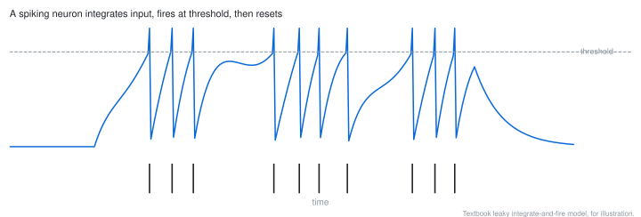

  

**MorphoNerva, Inc.** is an early-stage engineering R&D company building **event-driven, brain-inspired computing systems** for edge and scientific workloads. We design the full stack together: spiking neural network models, the software that compiles and verifies them, and the digital hardware they run on. Our first target is FPGA prototypes, with a path to custom silicon.

> Most sensor data is quiet most of the time. Conventional processors do the same work on every clock tick anyway. Our systems are designed to do work only when something changes.

---

### Why event-driven

<picture>
  <source media="(prefers-color-scheme: dark)" srcset="https://raw.githubusercontent.com/MorphoNerva-Inc/.github/main/profile/assets/event-driven-dark.svg">
  
</picture>

In an event-driven system, energy and work scale with **activity**, not with the clock. That matters wherever power, heat or always-on operation is the limit: battery and remote sensors, machines that must be monitored continuously, robots, and scientific instruments.

### How it works

<picture>
  <source media="(prefers-color-scheme: dark)" srcset="https://raw.githubusercontent.com/MorphoNerva-Inc/.github/main/profile/assets/spiking-neuron-dark.svg">
  
</picture>

Spiking neurons integrate their inputs over time and communicate with sparse, discrete events (spikes). We design models and circuits together, so **the model we train is exactly the model the hardware computes**, down to the last bit.

### The platform

<picture>
  <source media="(prefers-color-scheme: dark)" srcset="https://raw.githubusercontent.com/MorphoNerva-Inc/.github/main/profile/assets/platform-dark.svg">
  
</picture>

| | What it is | Status |
|---|---|---|
| **OmniSim** | Simulator that reproduces our hardware's arithmetic exactly and estimates its cost (memory, events, energy proxies) before anything is built | In development |
| **OmniSDK** | Toolchain that takes a trained spiking model, checks it, and maps it onto MorphoNerva hardware | In development |
| **Prototype 0** | Digital spiking-neural-network core, verified against OmniSim, implemented on an AMD FPGA | In development |
| **Prototype 1** | First measured latency and power results on hardware | Planned |

We build on open interchange formats such as the [Neuromorphic Intermediate Representation (NIR)](https://neuroir.org), so models trained in common open-source frameworks can move into our tools.

### Where it applies

- **Industrial monitoring:** always-on sound and vibration analysis for machine health
- **Audio and keyword sensing** at very low power
- **Event cameras and robotics:** reacting to motion with low latency
- **Scientific and harsh-environment sensing:** instruments where power, heat or bandwidth is constrained

### How we report results

Every number we publish carries a label: **measured**, **sourced** (someone else's published result), **estimated**, or **target**. A measured result always states the workload, hardware, precision and what the power measurement included. We will publish performance results when they are measured on our own hardware, not before.

### Work with us

We are interested in conversations with:

- **Pilot partners** who have an always-on sensing problem where power or latency is the bottleneck
- **Research collaborators** in neuromorphic computing, low-power signal processing and hardware/software co-design
- **Engineers and students** who want to build this with us

📫 **Contact:** a company contact address is coming soon. Until then, follow this organization for updates.

Registered US small business (SAM.gov). Our engineering repositories are private while the technology is under development; public tools and benchmarks will be released here as they reach validation and IP-review milestones.

© 2026 MorphoNerva, Inc. All rights reserved. Figures on this page are illustrations, not measured results.
