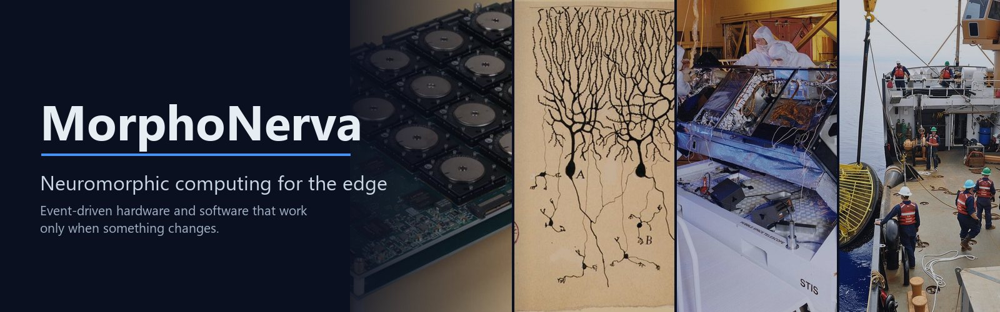

  
   Banner: public-domain images from DARPA, Santiago Ramón y Cajal (1899), NASA and the U.S. Coast Guard. None show MorphoNerva hardware. <a href="https://github.com/MorphoNerva-Inc/.github/blob/main/profile/assets/SOURCES.md">Image credits</a>.

<h3 align="center"><a href="https://morphonerva-inc.github.io">morphonerva-inc.github.io</a></h3>

  <a href="https://morphonerva-inc.github.io/technology/">How it works</a> ·
  <a href="https://morphonerva-inc.github.io/research/">Research</a> ·
  <a href="https://morphonerva-inc.github.io/roadmap/">Roadmap</a> ·
  <a href="https://morphonerva-inc.github.io/collaborate/">Work with us</a> ·
  <a href="https://morphonerva-inc.github.io/contact/">Contact</a>

## Computing that wakes up when the world changes

Most sensors spend most of their time watching nothing happen. Conventional processors still run at full speed through all of it, and that wastes power exactly where power is scarcest: on batteries, solar panels and remote equipment.

**MorphoNerva, Inc.** builds brain-inspired (neuromorphic) processors that do work only when their inputs change, together with the software to build and run models on them. Our first prototypes run on FPGAs. Custom silicon is the goal.

| | |
|---|---|
| **MorphoNerva core** | An event-driven neural processor for always-on sensing. In development, on FPGA first. |
| **OmniSim** | A simulator built so that what you simulate is what the chip computes. In development. |
| **OmniSDK** | Tools to bring a model from common frameworks through the open [NIR](https://github.com/neuromorphs/NIR) format onto our hardware. In development. |

**Where it matters:** machines and infrastructure, remote and harsh places, and vision and robotics.

## Where we are

We're building our first prototype core. **We'll publish performance numbers only after we've measured them on our own hardware.**

<picture>
  <source media="(prefers-color-scheme: dark)" srcset="https://raw.githubusercontent.com/MorphoNerva-Inc/.github/main/profile/assets/roadmap-dark.svg">
  
</picture>

## Work with us

We want to hear from **pilot partners** with an always-on sensing problem, **research collaborators** in neuromorphic computing and low-power chip design, and **engineers and students** interested in spiking neural networks, digital design, FPGAs, compilers and power measurement.

👉 **[Tell us about your interest](https://github.com/MorphoNerva-Inc/.github/issues/new?template=collaboration.yml)**. It's a short public form, so please don't include confidential details.

Our engineering repositories are private while the technology is in development. Tools, benchmarks and papers will be released here when they're ready. Follow the organization to hear about them.

---

© 2026 MorphoNerva, Inc. Registered US small business (SAM.gov). Diagrams are illustrations, not measurement results. <a href="https://github.com/MorphoNerva-Inc/.github/blob/main/profile/assets/SOURCES.md">Image credits</a> · <a href="https://github.com/MorphoNerva-Inc/.github/blob/main/CONTRIBUTING.md">Contributing</a> · <a href="https://github.com/MorphoNerva-Inc/.github/blob/main/CODE_OF_CONDUCT.md">Code of conduct</a> · <a href="https://github.com/MorphoNerva-Inc/.github/blob/main/SECURITY.md">Security</a>
