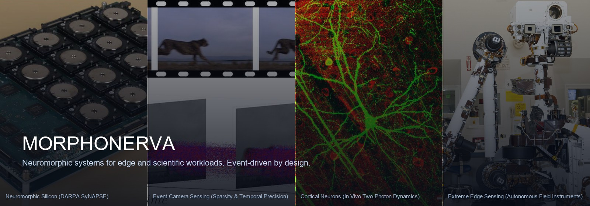
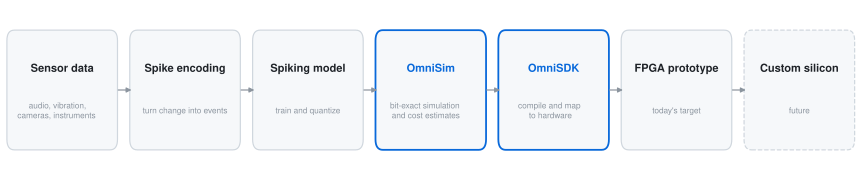
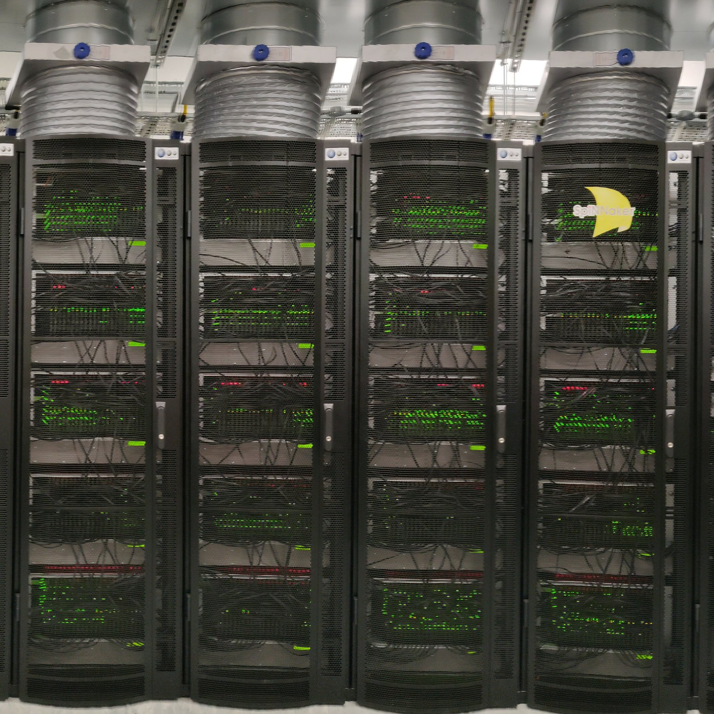
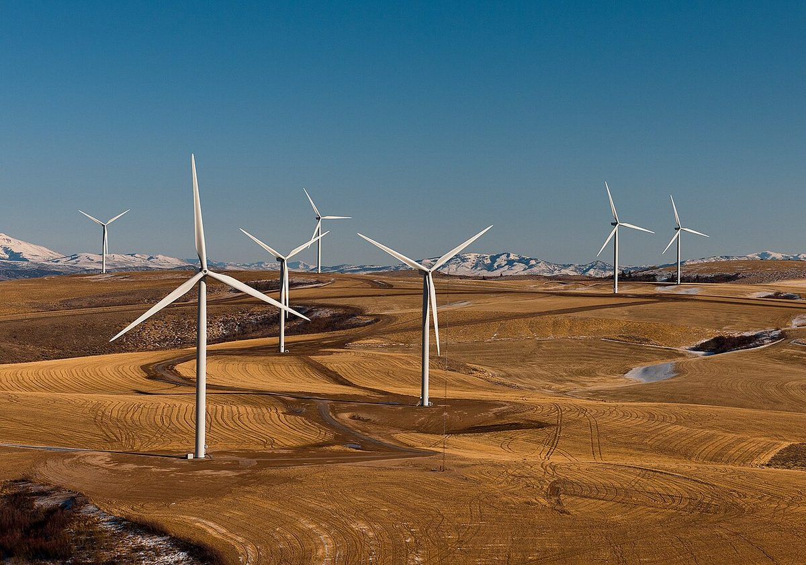
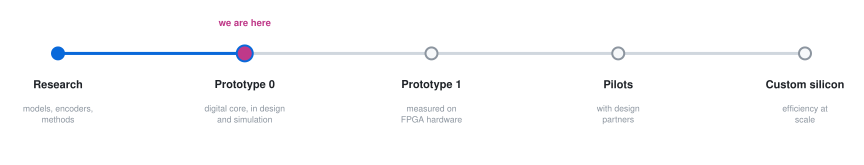

  

  <a href="https://morphonerva-inc.github.io"><strong>🌐 Official Website: morphonerva-inc.github.io</strong></a>

  <a href="https://morphonerva-inc.github.io/technology/">Technology</a> ·
  <a href="https://morphonerva-inc.github.io/research/">Research & Standards</a> ·
  <a href="https://morphonerva-inc.github.io/roadmap/">Roadmap & Evidence</a> ·
  <a href="https://morphonerva-inc.github.io/collaborate/">Careers & Collaborate</a> ·
  <a href="https://morphonerva-inc.github.io/contact/">Contact</a>

  
  
  
  
  

## Mission

**MorphoNerva, Inc.** is an engineering R&D company building **event-driven digital neuromorphic systems** for edge, remote sensing, and scientific workloads. Our mission is to make always-on intelligence practical where power, heat, and latency are the physical limits: put computation directly next to the sensor, and spend energy only when the physical world changes.

We co-design the complete stack: spiking neural network models, simulation toolchains, and digital hardware architectures. We prototype on FPGAs first and are architecting toward specialized custom silicon.

> Most sensor data is quiet most of the time. Conventional processors execute dense operations on every clock tick anyway. Our systems are designed to do work only when something changes.

---

## What We Build

<picture>
  <source media="(prefers-color-scheme: dark)" srcset="https://raw.githubusercontent.com/MorphoNerva-Inc/.github/main/profile/assets/platform-dark.svg">
  
</picture>

| Component | Description | Target Users | Status |
|---|---|---|---|
| **Neuromorphic Edge Accelerator** | Digital, event-driven neural processing core for always-on edge sensing. Prototyped on FPGA (Prototype 0) toward custom silicon | Product teams building battery-powered or remote sensing devices | In development |
| **OmniSim** | Simulation and numerical verification environment for spiking models, ensuring simulation matches hardware bit-for-bit | Researchers and model architects | In development |
| **OmniSDK** | Compiler and deployment toolkit to import, optimize, and deploy spiking models starting from the open [NIR](https://github.com/neuromorphs/NIR) standard | Embedded and application engineers | In development |

👉 *For detailed architectural discussions, see our [Technology Architecture](https://morphonerva-inc.github.io/technology/).*

---

## Representative Hardware & Sensing Heritage

Neuromorphic computing builds on established public research across brain-inspired hardware, dynamic vision sensors, and biology:

  
   A 16-chip brain-inspired computing board from DARPA's SyNAPSE programme (2014). Not MorphoNerva hardware. Photo: DARPA, <a href="https://commons.wikimedia.org/wiki/File:DARPA_SyNAPSE_16_Chip_Board.jpg">Wikimedia Commons</a>, public domain.

  
   Conventional video frames (top) send redundant data continuously; event cameras (bottom) report only changing pixels asynchronously. Photo: TimoStoffregen, <a href="https://commons.wikimedia.org/wiki/File:Event_camera_comparison.jpg">Wikimedia Commons</a>, CC BY-SA 4.0.

  
   The SpiNNaker 1-million-core neuromorphic supercomputer demonstrating scalable digital spike routing. Photo: Pabogdan, <a href="https://commons.wikimedia.org/wiki/File:Spinn_1m_pano_(cropped).jpg">Wikimedia Commons</a>, CC BY-SA 4.0.

---

## Target Applications

| Domain | Edge Challenge | MorphoNerva Event-Driven Approach |
|---|---|---|
| 🏭 **Industrial Monitoring** | High-frequency acoustic/vibrational sampling drains battery | Low-power listening; instant event bursts upon anomaly detection |
| 🎙️ **Audio Sensing** | Continuous DSP processing across quiet acoustic environments | Sub-milliwatt event detection, waking systems only on acoustic events |
| 🤖 **Event Cameras & Robotics** | High frame rates flood memory bandwidth and add latency | Sub-millisecond latency processing directly from dynamic vision sensors |
| 🔬 **Scientific & Harsh Sensing** | Remote instruments operate under severe power/thermal limits | In-situ intelligent event detection before telemetry transmission |

  
   Remote infrastructure assets benefit from low-power, always-on event-driven monitoring. Photo: U.S. Department of Energy, <a href="https://commons.wikimedia.org/wiki/File:Power_County_Wind_Farm_002.jpg">Wikimedia Commons</a>, public domain.

---

## Current Status & Roadmap

<picture>
  <source media="(prefers-color-scheme: dark)" srcset="https://raw.githubusercontent.com/MorphoNerva-Inc/.github/main/profile/assets/roadmap-dark.svg">
  
</picture>

We are actively engineering **Prototype 0**: the first digital core, verified in simulation and formal property proofs prior to FPGA synthesis.

### The Evidence Ladder
We publish only **Measured** or **Sourced** numbers. Target and Estimated figures are never presented as performance results:

<picture>
  <source media="(prefers-color-scheme: dark)" srcset="https://raw.githubusercontent.com/MorphoNerva-Inc/.github/main/profile/assets/evidence-ladder-dark.svg">
  
</picture>

**No performance numbers are published yet.** First results will be published once characterized on physical hardware with stated workload and power boundaries.

👉 *Read more about our verification pipeline and evidence standards on our [Roadmap Page](https://morphonerva-inc.github.io/roadmap/).*

---

## How to Engage

We are building a collaborative network across industry and academia:
- **Pilot Partners:** Teams with edge sensing workloads constrained by power, thermal, or latency limits.
- **Research Collaborators:** Researchers in spiking neural network algorithms, event vision, and formal digital verification.
- **Engineers & Students:** Contributors in digital RTL (SystemVerilog), formal verification, compiler toolchains (OmniSDK), and FPGA bring-up.

👉 **[Submit a Collaboration Request](https://github.com/MorphoNerva-Inc/.github/issues/new?template=collaboration.yml)** (a short public form; please do not include confidential details).

For more details on engagement, visit our [Careers & Collaborate Page](https://morphonerva-inc.github.io/collaborate/).

---

&copy; 2026 MorphoNerva, Inc. All rights reserved. Registered US small business (SAM.gov). MorphoNerva diagrams and charts are based on textbook models and synthetic data, not measured results. Photographs and third-party illustrations are used under licence with full attribution in <a href="https://github.com/MorphoNerva-Inc/.github/blob/main/profile/assets/SOURCES.md">SOURCES.md</a>. See <a href="https://github.com/MorphoNerva-Inc/.github/blob/main/CONTRIBUTING.md">contributing</a>, <a href="https://github.com/MorphoNerva-Inc/.github/blob/main/CODE_OF_CONDUCT.md">code of conduct</a>, and <a href="https://github.com/MorphoNerva-Inc/.github/blob/main/SECURITY.md">security</a>.
