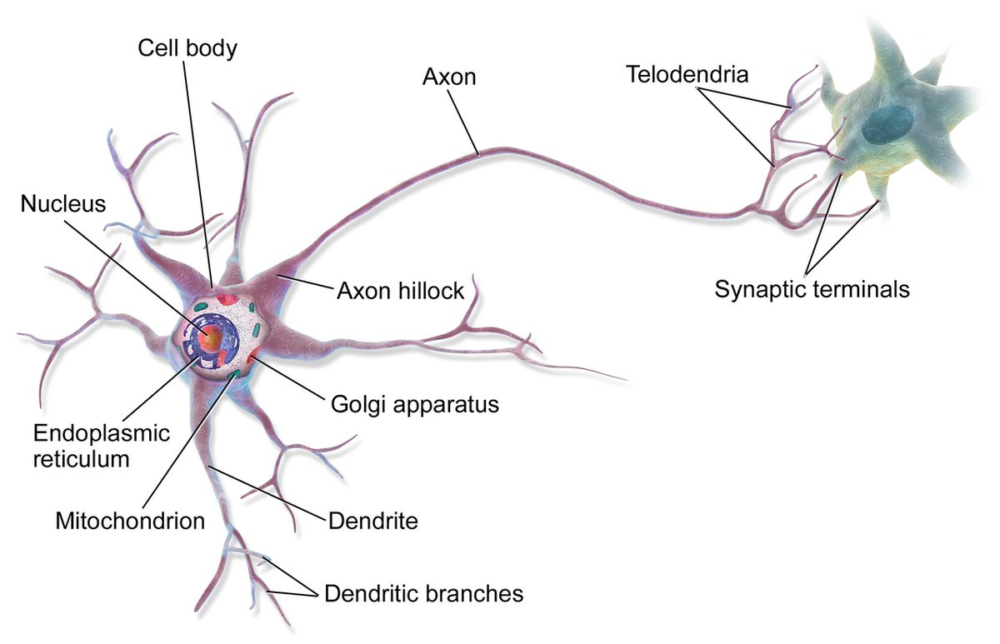
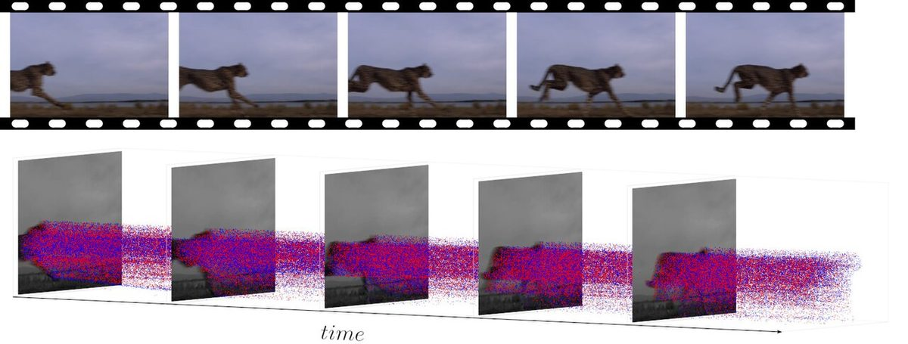
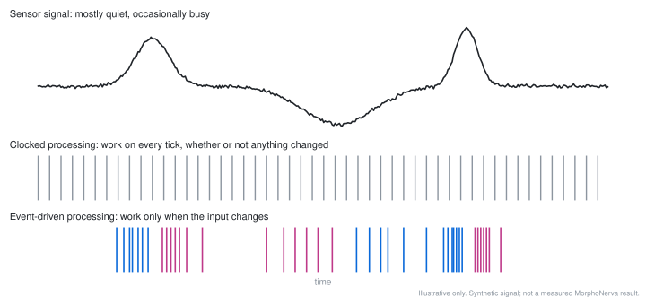
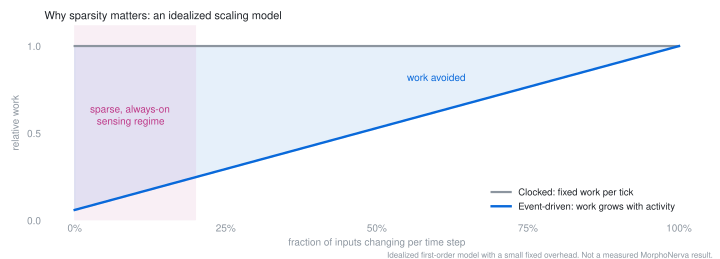
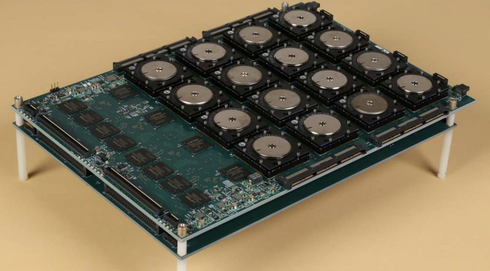
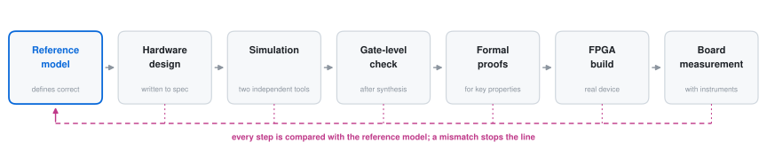

  

  
  
  
  
  

  <a href="#mission">Mission</a> ·
  <a href="#what-we-build">What we build</a> ·
  <a href="#why-it-matters">Why it matters</a> ·
  <a href="#current-status">Current status</a> ·
  <a href="#how-to-engage">How to engage</a>

## Mission

**MorphoNerva, Inc.** is an early-stage engineering R&D company building **neuromorphic, event-driven computing systems** for edge and scientific workloads. Our mission is to make always-on intelligence practical where power, heat and latency are the limits: put the computation next to the sensor, and spend energy only when the world changes.

We design the full stack together: spiking neural network models, the software that builds and verifies them, and the digital hardware they run on. We start with FPGA prototypes and are working toward custom silicon.

> Most sensor data is quiet most of the time. Conventional processors do the same work on every clock tick anyway. Our systems are designed to do work only when something changes.

## What we build

<picture>
  <source media="(prefers-color-scheme: dark)" srcset="https://raw.githubusercontent.com/MorphoNerva-Inc/.github/main/profile/assets/platform-dark.svg">
  
</picture>

| | What it is | Who it is for | Status |
|---|---|---|---|
| **Neuromorphic edge accelerator** | A digital, event-driven neural processing core for always-on sensing, prototyped on FPGA first, with custom silicon as the long-term goal | Product teams building battery-powered, embedded or remote sensing systems | In development |
| **OmniSim** | Simulation and analysis environment for spiking models, built so that what you simulate is what the hardware computes | Researchers and model developers | In development |
| **OmniSDK** | Developer toolkit to import, build and deploy spiking models on MorphoNerva hardware, starting from the open [NIR](https://github.com/neuromorphs/NIR) model format | Application and embedded engineers | In development |

We co-design models and circuits with one goal: **the model we train is the model the hardware computes**, with no hand-off step where accuracy silently changes.

<b>How spiking neural networks work (a two-minute primer)</b>

 

Our designs borrow one idea from biology. A neuron collects inputs from many others, and only when enough arrive does it send a short pulse (a spike) to the next cells. Between spikes it does almost nothing.

  
   A biological neuron. Inputs arrive on the dendrites; the output spike travels down the axon. Illustration: BruceBlaus, <a href="https://commons.wikimedia.org/wiki/File:Blausen_0657_MultipolarNeuron.png">Wikimedia Commons</a>, CC BY 3.0 (resized).

Spiking neural networks keep that behaviour in a simplified, digital form. Each model neuron integrates its inputs over time and fires when it crosses a threshold:

<picture>
  <source media="(prefers-color-scheme: dark)" srcset="https://raw.githubusercontent.com/MorphoNerva-Inc/.github/main/profile/assets/spiking-neuron-dark.svg">
  
</picture>

Across a network, only a small share of neurons is active at any moment. That sparsity is what event-driven hardware is built to exploit:

<picture>
  <source media="(prefers-color-scheme: dark)" srcset="https://raw.githubusercontent.com/MorphoNerva-Inc/.github/main/profile/assets/sparse-raster-dark.svg">
  
</picture>

Both figures are textbook illustrations drawn from synthetic data, not measurements.

## Why it matters

Sensors are moving to the edge: on machines, in vehicles, on robots and in remote instruments. Many of them must listen or watch all the time, on a small power budget, far from a data centre.

**Event sensors already work this way.** A conventional camera sends every pixel of every frame. An event camera reports only the pixels that change, as a sparse stream of events:

  
   Same scene, two sensors: conventional frames (top) and event-camera output (bottom). Image: TimoStoffregen, <a href="https://commons.wikimedia.org/wiki/File:Event_camera_comparison.jpg">Wikimedia Commons</a>, CC BY-SA 4.0 (resized).

Clocked processors turn that sparse signal back into dense work. In an event-driven system, energy and work scale with **activity**, not with the clock:

<picture>
  <source media="(prefers-color-scheme: dark)" srcset="https://raw.githubusercontent.com/MorphoNerva-Inc/.github/main/profile/assets/event-driven-dark.svg">
  
</picture>

<picture>
  <source media="(prefers-color-scheme: dark)" srcset="https://raw.githubusercontent.com/MorphoNerva-Inc/.github/main/profile/assets/activity-scaling-dark.svg">
  
</picture>

The first-order argument is simple. If a fraction *a* of inputs changes per step, clocked work is constant, while event-driven work is roughly *c₀ + a·c₁*. The engineering problem is keeping the fixed overhead *c₀* small and the sparsity real on real data, without giving up accuracy. That is the problem we work on.

### Where it applies

  
   Remote, always-on assets are a natural fit for low-power monitoring at the sensor. Photo: U.S. Department of Energy, <a href="https://commons.wikimedia.org/wiki/File:Power_County_Wind_Farm_002.jpg">Wikimedia Commons</a>, public domain (resized).

| Domain | Example problem |
|---|---|
| 🏭 **Industrial monitoring** | Always-on sound and vibration analysis for machine health |
| 🎙️ **Audio sensing** | Keyword and acoustic event detection on a small power budget |
| 🤖 **Event cameras and robotics** | Reacting to motion with low latency |
| 🔬 **Scientific and harsh-environment sensing** | Instruments where power, heat or bandwidth is constrained |

<b>Neuromorphic hardware is an established research field</b>

 

Brain-inspired chips have been built and studied for years by government, academic and industry programmes. Our work builds on that public research. We focus on making it practical for edge products, with verification and honest benchmarking at the centre.

  
   A 16-chip brain-inspired computing board from DARPA's SyNAPSE programme (2014). Not MorphoNerva hardware. Photo: DARPA, <a href="https://commons.wikimedia.org/wiki/File:DARPA_SyNAPSE_16_Chip_Board.jpg">Wikimedia Commons</a>, public domain (resized).

## Current status

<picture>
  <source media="(prefers-color-scheme: dark)" srcset="https://raw.githubusercontent.com/MorphoNerva-Inc/.github/main/profile/assets/roadmap-dark.svg">
  
</picture>

We are building **Prototype 0**: the first digital core, designed and checked in simulation before it goes onto FPGA hardware.

**No performance results are published yet.** Neuromorphic computing has a reputation for big claims, and we would rather show our work. We publish only **Measured** or **Sourced** numbers, and each one says how strong the evidence behind it is:

<picture>
  <source media="(prefers-color-scheme: dark)" srcset="https://raw.githubusercontent.com/MorphoNerva-Inc/.github/main/profile/assets/evidence-ladder-dark.svg">
  
</picture>

The first results will appear here once they are measured on our own hardware, with the hardware, workload and power boundary stated.

<b>How we check our work: from model to board</b>

 

Before anything counts, it is checked against a reference model at every step:

<picture>
  <source media="(prefers-color-scheme: dark)" srcset="https://raw.githubusercontent.com/MorphoNerva-Inc/.github/main/profile/assets/verification-flow-dark.svg">
  
</picture>

<b>How we work: engineering standards</b>

 

| Standard | What it means |
|---|---|
| **Pre-registered experiments** | Hypothesis, comparison arms, ≥ 3 random seeds and a kill criterion are written down before a run |
| **Strong baselines** | Every result is compared with a well-tuned conventional model at matched size, not a weak straw man |
| **Model = hardware** | Hardware is verified step by step against a reference model before it counts |
| **Negative results kept** | An experiment that fails is recorded with its reason, and revisited when conditions change |
| **Clean provenance** | Every dataset, dependency and design decision has a recorded source and licence |

<b>How we report results: evidence labels</b>

 

We publish only **Measured** or **Sourced** numbers. The other two labels describe work in progress and never come with a number:

| Label | Meaning |
|---|---|
| **Measured** | Run by us on stated hardware, with workload and power boundary given |
| **Sourced** | Someone else's published result, cited |
| **Estimated** | From a model or simulation; used internally, not published as a number |
| **Target** | A goal, not a result; stated without numbers |

## How to engage

We are building a small, rigorous team and network. We especially want to hear from:

- **Pilot partners** with an always-on sensing problem where power or latency is the bottleneck
- **Research collaborators** in neuromorphic computing, low-power signal processing, digital design and verification
- **Engineers and students** interested in SNN training, RTL design and verification, FPGA implementation, compilers and runtime software, or power measurement

👉 **[Tell us about your interest](https://github.com/MorphoNerva-Inc/.github/issues/new?template=collaboration.yml)** (a short public form; please don't include confidential details). A company contact address is coming soon.

Our engineering repositories are private while the technology is under development. Public tools, benchmarks and papers will be released here as they reach validation and IP-review milestones. Follow the organization to be notified.

<b>Research questions we care about</b>

 

- How much activity sparsity survives on real sensor data, not just benchmarks, and what does it cost in accuracy?
- Which ways of turning continuous signals into events (encodings) work best for which signals?
- How should training account for the exact arithmetic of low-precision digital hardware?
- How do you verify a neural processor so that simulation and silicon agree on every step?
- When does event-driven hardware beat a well-optimized conventional baseline, and when does it not?

<b>New to neuromorphic computing? Good public starting points</b>

 

- [*Neuronal Dynamics*](https://neuronaldynamics.epfl.ch/online/index.html), Gerstner, Kistler, Naud and Paninski: a free online textbook on spiking neuron models
- Roy, Jaiswal and Panda, [*Towards spike-based machine intelligence with neuromorphic computing*](https://doi.org/10.1038/s41586-019-1677-2), Nature (2019): an overview of the field
- Eshraghian et al., [*Training Spiking Neural Networks Using Lessons From Deep Learning*](https://arxiv.org/abs/2109.12894): a practical tutorial on training SNNs
- [NIR](https://github.com/neuromorphs/NIR), the Neuromorphic Intermediate Representation: an open format for exchanging spiking models between frameworks and hardware
- [Open Neuromorphic](https://open-neuromorphic.org): a community hub for open neuromorphic research and tools

---

© 2026 MorphoNerva, Inc. All rights reserved. Registered US small business (SAM.gov). MorphoNerva figures on this page are diagrams or illustrations based on textbook models and synthetic data, not measured results. Photographs and third-party illustrations are used under their licences; credits are in each caption and in <a href="https://github.com/MorphoNerva-Inc/.github/blob/main/profile/assets/SOURCES.md">image sources</a>. See <a href="https://github.com/MorphoNerva-Inc/.github/blob/main/CONTRIBUTING.md">contributing</a>, <a href="https://github.com/MorphoNerva-Inc/.github/blob/main/CODE_OF_CONDUCT.md">code of conduct</a> and <a href="https://github.com/MorphoNerva-Inc/.github/blob/main/SECURITY.md">security</a>.
