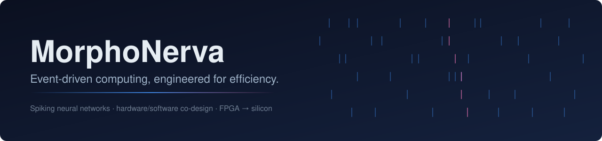
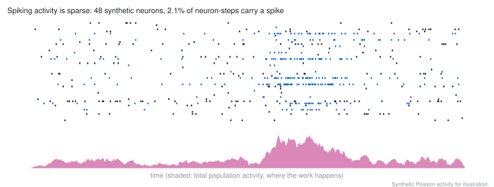
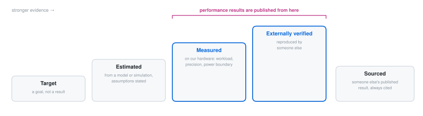

  

  
  
  
  
  

  <a href="#why-event-driven">Why event-driven</a> ·
  <a href="#how-it-works">How it works</a> ·
  <a href="#the-platform">Platform</a> ·
  <a href="#evidence-not-adjectives">Evidence</a> ·
  <a href="#roadmap">Roadmap</a> ·
  <a href="#for-researchers-and-engineers">For researchers</a> ·
  <a href="#work-with-us">Work with us</a>

**MorphoNerva, Inc.** is an early-stage engineering R&D company building **event-driven, brain-inspired computing systems** for edge and scientific workloads. We design the full stack together: spiking neural network models, the software that builds and verifies them, and the digital hardware they run on. We start with FPGA prototypes and are working toward custom silicon.

> Most sensor data is quiet most of the time. Conventional processors do the same work on every clock tick anyway. Our systems are designed to do work only when something changes.

---

## Why event-driven

<picture>
  <source media="(prefers-color-scheme: dark)" srcset="https://raw.githubusercontent.com/MorphoNerva-Inc/.github/main/profile/assets/event-driven-dark.svg">
  
</picture>

In an event-driven system, energy and work scale with **activity**, not with the clock. That matters wherever power, heat or always-on operation is the limit.

<picture>
  <source media="(prefers-color-scheme: dark)" srcset="https://raw.githubusercontent.com/MorphoNerva-Inc/.github/main/profile/assets/activity-scaling-dark.svg">
  
</picture>

The first-order argument is simple. If a fraction *a* of inputs changes per step, clocked work is constant, while event-driven work is roughly *c₀ + a·c₁*. The engineering problem is keeping the fixed overhead *c₀* small and the sparsity real on real data, without giving up accuracy. That is the problem we work on.

## How it works

<picture>
  <source media="(prefers-color-scheme: dark)" srcset="https://raw.githubusercontent.com/MorphoNerva-Inc/.github/main/profile/assets/spiking-neuron-dark.svg">
  
</picture>

Spiking neurons integrate their inputs over time and communicate with sparse, discrete events (spikes). Across a network, only a small share of neurons is active at any moment:

<picture>
  <source media="(prefers-color-scheme: dark)" srcset="https://raw.githubusercontent.com/MorphoNerva-Inc/.github/main/profile/assets/sparse-raster-dark.svg">
  
</picture>

We co-design models and circuits with one goal: **the model we train is the model the hardware computes**, with no hand-off step where accuracy silently changes.

## The platform

<picture>
  <source media="(prefers-color-scheme: dark)" srcset="https://raw.githubusercontent.com/MorphoNerva-Inc/.github/main/profile/assets/platform-dark.svg">
  
</picture>

| | What it is | Status |
|---|---|---|
| **OmniSim** | Simulation and analysis environment for spiking models on MorphoNerva hardware | In development |
| **OmniSDK** | Developer toolkit for building and deploying spiking models on MorphoNerva hardware | In development |
| **MorphoNerva cores** | Digital event-driven neural processing cores, prototyped on FPGA first | In development |

## Evidence, not adjectives

Neuromorphic computing has a reputation for big claims. We would rather show our work. We publish only **Measured** or **Sourced** numbers, and each one says how strong the evidence behind it is:

<picture>
  <source media="(prefers-color-scheme: dark)" srcset="https://raw.githubusercontent.com/MorphoNerva-Inc/.github/main/profile/assets/evidence-ladder-dark.svg">
  
</picture>

**No performance results are published yet.** The first ones will appear here once they are measured on our own hardware, with the hardware, workload and power boundary stated.

Before anything counts, it is checked against a reference model at every step, from the first model to the board:

<picture>
  <source media="(prefers-color-scheme: dark)" srcset="https://raw.githubusercontent.com/MorphoNerva-Inc/.github/main/profile/assets/verification-flow-dark.svg">
  
</picture>

## Roadmap

<picture>
  <source media="(prefers-color-scheme: dark)" srcset="https://raw.githubusercontent.com/MorphoNerva-Inc/.github/main/profile/assets/roadmap-dark.svg">
  
</picture>

## Where it applies

| Domain | Example problem |
|---|---|
| 🏭 **Industrial monitoring** | Always-on sound and vibration analysis for machine health |
| 🎙️ **Audio sensing** | Keyword and acoustic event detection at very low power |
| 🤖 **Event cameras and robotics** | Reacting to motion with low latency |
| 🔬 **Scientific and harsh-environment sensing** | Instruments where power, heat or bandwidth is constrained |

## For researchers and engineers

<b>Research questions we care about</b>

 

- How much activity sparsity survives on real sensor data, not just benchmarks, and what does it cost in accuracy?
- Which ways of turning continuous signals into events (encodings) work best for which signals?
- How should training account for the exact arithmetic of low-precision digital hardware?
- How do you verify a neural processor so that simulation and silicon agree on every step?
- When does event-driven hardware beat a well-optimized conventional baseline, and when does it not?

<b>How we work: engineering standards</b>

 

| Standard | What it means |
|---|---|
| **Pre-registered experiments** | Hypothesis, comparison arms, ≥ 3 random seeds and a kill criterion are written down before a run |
| **Strong baselines** | Every result is compared with a well-tuned conventional model at matched size, not a weak straw man |
| **Model = hardware** | Hardware is verified step by step against a reference model before it counts |
| **Negative results kept** | An experiment that fails is recorded with its reason, and revisited when conditions change |
| **Clean provenance** | Every dataset, dependency and design decision has a recorded source and licence |

<b>How we report results</b>

 

We publish only **Measured** or **Sourced** numbers. The other two labels describe work in progress and never come with a number:

| Label | Meaning |
|---|---|
| **Measured** | Run by us on stated hardware, with workload and power boundary given |
| **Sourced** | Someone else's published result, cited |
| **Estimated** | From a model or simulation; used internally, not published as a number |
| **Target** | A goal, not a result; stated without numbers |

We publish performance results once they are measured on our own hardware, not before.

<b>New to neuromorphic computing? Good public starting points</b>

 

- [*Neuronal Dynamics*](https://neuronaldynamics.epfl.ch/online/index.html), Gerstner, Kistler, Naud and Paninski: a free online textbook on spiking neuron models
- Roy, Jaiswal and Panda, [*Towards spike-based machine intelligence with neuromorphic computing*](https://doi.org/10.1038/s41586-019-1677-2), Nature (2019): an overview of the field
- Eshraghian et al., [*Training Spiking Neural Networks Using Lessons From Deep Learning*](https://arxiv.org/abs/2109.12894): a practical tutorial on training SNNs
- [Open Neuromorphic](https://open-neuromorphic.org): a community hub for open neuromorphic research and tools

## Work with us

We are building a small, rigorous team and network. We especially want to hear from:

- **Pilot partners** with an always-on sensing problem where power or latency is the bottleneck
- **Research collaborators** in neuromorphic computing, low-power signal processing, digital design and verification
- **Engineers and students** interested in SNN training, RTL design and verification, FPGA implementation, compilers and runtime software, or power measurement

👉 **[Tell us about your interest](https://github.com/MorphoNerva-Inc/.github/issues/new?template=collaboration.yml)** (a short public form; please don't include confidential details). A company contact address is coming soon.

Our engineering repositories are private while the technology is under development. Public tools, benchmarks and papers will be released here as they reach validation and IP-review milestones. Follow the organization to be notified.

---

© 2026 MorphoNerva, Inc. All rights reserved. Registered US small business (SAM.gov). Figures on this page are diagrams or illustrations based on textbook models and synthetic data, not measured results. See <a href="https://github.com/MorphoNerva-Inc/.github/blob/main/CONTRIBUTING.md">contributing</a>, <a href="https://github.com/MorphoNerva-Inc/.github/blob/main/CODE_OF_CONDUCT.md">code of conduct</a> and <a href="https://github.com/MorphoNerva-Inc/.github/blob/main/SECURITY.md">security</a>.
